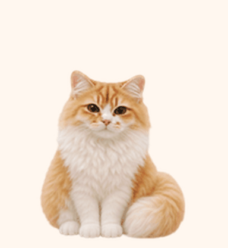

# 蛋黄 · 毛绒电子宠物

蛋黄是一只保留真实橘金白花色的长毛猫，贪吃、黏人，喜欢歪头、舔爪和甩尾巴。这是可在支持自定义 Pets 的桌面客户端上安装的 v2 动画包。



## 本次更新：1.1.2 · 摸摸爱心版

将鼠标放到蛋黄身上时，原来的跳跃反应改为“抬头迎接 → 闭眼蹭头 → 冒出粉色爱心 → 恢复坐姿”。五帧素材约 0.84 秒一遍；当前客户端默认播放三遍，共约 2.52 秒，再回到待机。移开再移入可重新触发。

本版基于已发布的 1.1.1 玩耍版，保留眨眼待机、逗猫棒、拨球、抱鱼轻蹬和十六个看向方向。未将此前停止制作的哈欠趴睡草稿混入此次发布。

详细修改内容、校验范围和远端应用状态见 [CHANGELOG.md](CHANGELOG.md)。

## 下载与安装

[下载完整安装包 v1.1.2](https://github.com/Sweet4tars/danhuang-pet/raw/refs/heads/main/dist/danhuang-pet-v1.1.2.zip)。仓库已公开，下载后可直接转发给另一台电脑。解压和安装无需 GitHub 登录或网络。

把完整安装压缩包交给另一台电脑的 Codex，并告诉它：

> 请阅读包内“给Codex的安装说明.md”，校验并安装这个蛋黄电子宠物，已有版本先备份；最后确认新悬停动作是否实际显示。

也可克隆仓库：

```sh
git clone https://github.com/Sweet4tars/danhuang-pet.git
cd danhuang-pet
python3 install.py --verify
python3 install.py
```

Windows 通常使用 `py -3 install.py`。默认安装到 `<CODEX_HOME>/pets/danhuang/`；没有设置 `CODEX_HOME` 时使用用户目录下的 `.codex`。安装工具支持完整备份旧版、相同版本跳过和指定 `--codex-home`。

安装后仍需通过客户端提供的宠物选择入口选择相应条目，并在目标电脑实际核验。若蛋黄已迁移为云端宠物，仅复制本地文件不会更新云端图集，应使用受支持的 Pets 图集更新接口更新原稳定 ID。

本次仓库发布包含新动画、离线预览、安装包和修改记录；当前会话没有加载 Pets 远端更新工具，云端蛋黄的图片替换尚未执行。仓库同步成功与云端宠物更新成功需要分别验证。

## 动作与触发

| 触发 | 蛋黄的动作 |
| --- | --- |
| 鼠标进入蛋黄身体 | 被抚摸、闭眼蹭头、冒出爱心、恢复坐姿 |
| 待机 / idle | 沿用眨眼待机 |
| 工作 / running | 坐姿拨球 |
| 需要输入 / waiting | 逗猫棒扑抓 |
| 完成且有未读结果 / review | 抱鱼轻蹬 |

任务动作由宿主聊天状态触发，不是随机轮播。完整说明见 [动作与触发说明](动作与触发说明.md)。


双击下载后的 [动作预览.html](动作预览.html) 可离线体验鼠标悬停和恢复待机。网页预览只验证素材效果，不向客户端发送状态。

## 文件与校验

- `danhuang/pet.json`：本地稳定 ID、名称、简介及 v2 声明。
- `danhuang/spritesheet.webp`：1536 × 2288 透明图集。
- `manifest.json`、`SHA256SUMS`：版本、文件大小与完整性校验。
- `install.py`、`给Codex的安装说明.md`：本地安装和备份。
- `previews/`、`动作预览.html`：动画与交互预览。
- `dist/danhuang-pet-v1.1.2.zip`：完整迁移安装包；旧版压缩包保留便于回退。
- `validation/hover-v1.1.2.json`：与本次最终图集绑定的校验摘要。

新图集 SHA-256：

```text
4507d42de5787c7f3a9e899e71e0f50259eec2e45a358e89e91416fd991b9d74
```

素材通过内置图像生成制作，所用提示词见 [抚摸爱心-生成提示词.txt](抚摸爱心-生成提示词.txt)。

## 使用许可与来源

欢迎免费下载并将本仓库的成品动画及安装工具用于自己的桌面电子宠物。分享项目时请保留仓库链接和来源说明。上述使用许可不包含商业再分发授权。

动画装配与校验参考的公开代码见 [ATTRIBUTION.md](ATTRIBUTION.md)。
