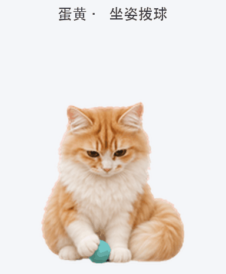

# 蛋黄 · 毛绒电子宠物

蛋黄是一只保留真实橘金白花色的长毛猫，贪吃、黏人，喜欢歪头、舔爪和甩尾巴。这是可在支持自定义 Pets 的桌面客户端上安装的 v2 动画包。



## 下载与安装

任何人都可以下载并将蛋黄安装为自己的桌面电子宠物，无需单独申请。完整安装压缩包可以直接转发给另一台电脑，解压和安装不需要 GitHub 账号或网络。

获得完整安装压缩包后，先阅读 [给 Codex 的安装说明](给Codex的安装说明.md)。GitHub 副本的 [安装压缩包](https://github.com/Sweet4tars/danhuang-pet/raw/refs/heads/main/dist/danhuang-pet-v1.1.1.zip) 和克隆入口也保留在这里；是否需要仓库访问权限，以 GitHub 当时的可见性设置为准：

```sh
git clone https://github.com/Sweet4tars/danhuang-pet.git
cd danhuang-pet
```

### 让 Codex 帮你安装

将完整安装压缩包发给另一台电脑的 Codex，并发送：

> 请解压附件，先阅读“给Codex的安装说明.md”，核对文件并安装蛋黄到本机 Pets。已有蛋黄先备份，保留其他宠物，最后告诉我如何刷新并选中蛋黄。

文件下载到本机后，安装不需要联网。

### 手动安装

在下载或克隆的仓库目录中，有 Python 3 时可运行：

```sh
python3 install.py --verify
python3 install.py
```

Windows 通常使用 `py -3 install.py`。如果没有 Python，Codex 也可以校验后手动复制 `danhuang` 文件夹。

默认安装位置是 `<CODEX_HOME>/pets/danhuang/`。没有设置 `CODEX_HOME` 时，macOS 为 `~/.codex/pets/danhuang/`，Windows 为 `%USERPROFILE%\.codex\pets\danhuang\`。使用自定义位置时可运行 `python3 install.py --codex-home "实际路径"`。

安装后在桌面客户端的 **设置 → Pets** 中刷新并选择“蛋黄”；若版本没有刷新按钮，可重新打开客户端。安装工具负责放置文件；选择宠物可能仍需在界面完成一次。目标电脑是否成功展示，应在该电脑确认。

## 本版动作

保留九类状态和十六个看向方向，将三组玩耍动作放入现有状态：

| 现有状态 | 蛋黄的动作 |
| --- | --- |
| 工作 / running | 用前爪拨动小球 |
| 等待 / waiting | 按住逗猫棒，歪头扑抓羽毛 |
| 完成且有未读结果 / review | 抱住小鱼玩具，后爪轻蹬 |

这些动作由聊天状态触发，平时不会随机轮播。当前核对的客户端会在状态切换时播放三遍对应动作，再回到慢速待机；鼠标悬停和拖动还会临时覆盖任务动作。详见 [动作与触发说明](动作与触发说明.md)。

双击 [动作预览.html](动作预览.html) 可离线检查素材。预览页按钮控制本地预览，不能向桌面客户端发送状态。

## 文件与版本

- `danhuang/pet.json`：名称、简介与 v2 格式声明。
- `danhuang/spritesheet.webp`：1536 × 2288 的透明动画图集。
- `install.py`：仅依赖 Python 标准库的安装工具，支持校验、重复安装检测和旧版备份。
- `manifest.json`、`SHA256SUMS`：版本及文件完整性校验。
- `dist/`：便于跨电脑传输的压缩包。
- `给Codex的安装说明.md`：供接收电脑的 Codex 执行安装。
- `动作与触发说明.md`：实际触发条件、短时播放机制与核验范围。
- `动作预览.html`：无需安装客户端即可打开的离线素材预览。

安装包版本：**1.1.1 · 迁移说明与触发核验版**；动画沿用 **1.1.0 玩耍版**。图集 SHA-256：

```text
cca3726f5daa1bd07cce4d96238844518c91a5f8094cb1210cd65c0275346c9e
```

自定义宠物通过本仓库在各电脑分别安装；GitHub 仓库更新后，需要在目标电脑重新获取并安装。图集为桌面 v2 格式，使用前需确认客户端支持 v2，不能直接当作其他尺寸格式的素材上传。

## 使用说明与来源

欢迎免费下载并将本仓库的成品动画及安装工具用于自己的桌面电子宠物。分享项目时请保留仓库链接和来源说明。上述使用许可不包含商业再分发授权。

动画装配与校验所参考的公开代码见 [ATTRIBUTION.md](ATTRIBUTION.md)。
